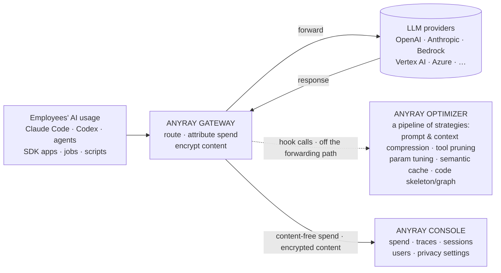

# Anyray

**Cut the AI-inference spend your own employees generate — without ever exposing their content.**

Developers run AI coding assistants, teams build internal agents and SDK apps, and jobs call
LLMs all day — across laptops and clusters. [Anyray](https://docs.anyray.ai) sits on the path of
every one of those requests, serves it as cheaply as it can, and gives the org visibility and
governance over the spend — **without exposing the content** (employees' source code and
proprietary data) to humans.

It's a **self-hosted gateway + console + optimizer**. One `docker compose up` brings up the
whole system.



## What you get

- 💸 **Spend governance** — every request is attributed (user / team via the
  `x-anyray-metadata` header, plus model, provider, tokens, cost) into a **content-free** spend
  store. See who spends what, across every provider.
- 🔒 **Content privacy by default** — prompt/response content is **encrypted at rest**
  (AES-256-GCM) and never shown to humans. Org-wide modes: `encrypted` (default) · `off` (store
  nothing) · `plaintext` (deploy-gated).
- ⚡ **An optimization platform, not one trick** — ten strategies run together (prompt & context
  compression, window-budget fitting, tool pruning, param tuning, semantic cache, code-aware
  skeletonization/graph selection, BM25 relevance filtering, local vision OCR) and **fail open**:
  if the optimizer is slow or down, the gateway forwards the original request untouched.
- 🔌 **Zero code change** — `npx anyray-connect` points local tools (Claude Code, Codex, Cursor,
  Windsurf) and SDK/shell env at the gateway. The real provider key stays server-side; the laptop
  only ever holds a placeholder.
- 🏠 **Fully self-hosted, zero egress** — content *and* metadata stay in your environment. The
  only optional exception is **Anyray Portal**, which phones home **content-free** billing
  rollups — never prompts, responses, or raw identities.

## Quick start

```bash
cp .env.example .env        # one file configures the whole stack
docker compose up -d        # builds the gateway + optimizer, starts everything
```

- **Console** → http://localhost:3000 — sign in with `ANYRAY_ADMIN_TOKEN`
- **Gateway API** → point your apps/SDKs at `http://localhost:8787/v1/...`

Only `:3000` and `:8787` are published to the host; everything else stays in-network.

## How well does it work?

The optimizer ships an **offline, reproducible** benchmark that runs synthetic agentic
workloads through the real strategy code and counts actual tokens before and after. Across eight
workloads (code search, service logs, RAG, GitHub triage, long conversations, …) it removes
**~80% of input tokens** — per-workload reductions of **55–96%**, no provider calls required.

## Explore

| | |
| --- | --- |
| 📚 **Documentation** | [docs.anyray.ai](https://docs.anyray.ai) |
| 🧰 **Source** | [`anyrayHQ/monorepo`](https://github.com/anyrayHQ/monorepo) — gateway, optimizer, console, `anyray-connect` |
| 🚀 **Install & operate** | [Org-admin guide](https://docs.anyray.ai/get-started/overview) |
| 👩‍💻 **Connect your tools** | [Developer guide](https://docs.anyray.ai/developers/overview) |
| 🔐 **Security & data boundary** | [Security](https://docs.anyray.ai/operate/security) · [Data boundary](https://docs.anyray.ai/operate/data-boundary) |

---

<sub>Found a security issue? See our [security policy](https://github.com/anyrayHQ/.github/blob/main/SECURITY.md). Everything else: [open an issue](https://github.com/anyrayHQ/monorepo/issues) or read the [contributing guide](https://github.com/anyrayHQ/.github/blob/main/CONTRIBUTING.md).</sub>
